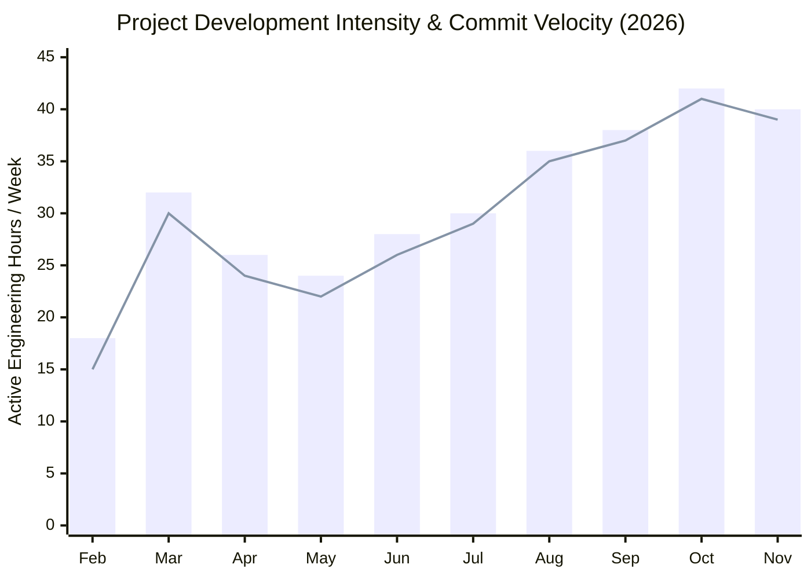
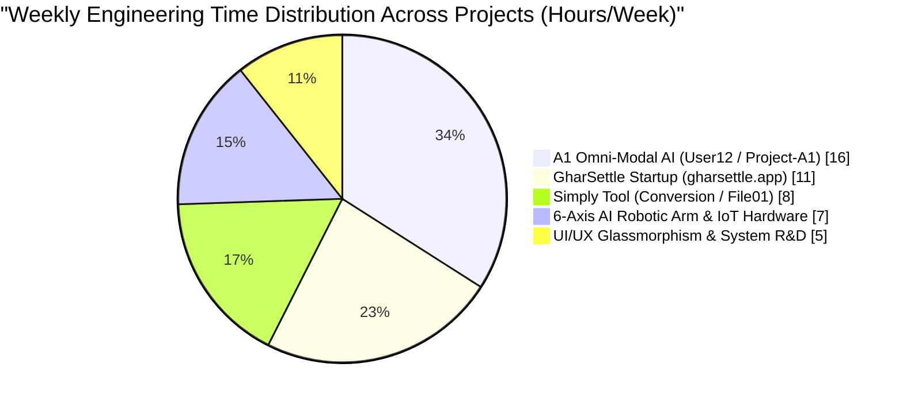

<!-- CIRCULAR PROFILE AVATAR FROM ROOT REPO IMAGE -->

# Hi there, I'm Pawan Ahirwar 

<!-- ANIMATED TYPING HEADER -->

  

<!-- LIVE STATUS & PROFILE BADGES -->

  
  
  
  

---

## 🧠 Engineering Mindset, Workflow & Learning Philosophy

> *"I don't just study concepts in isolation—I turn them into working products, live web platforms, and physical hardware systems."*

* **Build-First Learning Approach:** My learning method is strictly **execution-driven**. Whenever I explore a new concept—whether it is real-time Server-Sent Events (SSE), cloud-to-GPU tunneling, or microcontroller servo kinematics—I immediately build a working prototype, test edge cases, and deploy it to production.
* **Product-Oriented Thinking:** I love building tools that solve everyday friction. From **GharSettle** (eliminating the stress of setting up a home after moving) to **Simply Tool** (making file compression instant on both client and cloud) and **A1 Omni-Modal Workspace** (unifying text, math, code, image, audio, and video generation in one interface).
* **Hybrid Software + Hardware DNA:** I work seamlessly across the digital and physical worlds—designing **Glassmorphism & Neumorphism** web interfaces backed by **Python (FastAPI / Flask / Uvicorn)** and **MongoDB**, while also wiring **Raspberry Pi, ESP32, Arduino, and PWM servo controllers** powered by **Google Gemma AI models**.
* **Creative Energy:** When I am coding late-night architecture sprints, I generate and listen to **cyberpunk synthwave, lo-fi chillwave, ambient electronic soundscapes, and minimalist acoustic guitar loops** to stay in deep flow.

---

## 🌐 Featured Platforms, Startups & Core Projects

| Project / Product | Category & Status | Tech Stack & Architecture | Key Capabilities & Real-World Impact |
| :--- | :--- | :--- | :--- |
| **🏠 GharSettle** (`gharsettle.app`) | **Startup Platform** *(Live Domain)* | Full-Stack Web, Responsive UI, Cloud Backend, Booking Workflow | End-to-end post-moving house settlement platform offering professional unboxing, room setup, furniture placement, and home organization services. |
| **⚡ A1 Omni-Modal AI Workspace** (`User12` / `Project-A1-Core`) | **Flagship AI Platform** *(Public & Private)* | Python, FastAPI, Flask, Uvicorn, JS, Firebase Auth, MongoDB, Cloudflare Tunnel, KaTeX | 10-Framework multimodal AI engine supporting real-time SSE token streaming, 2s keep-alive heartbeats, universal LaTeX math rendering, IDE code boxes, and URL-based Image/MP4/MP3/PDF/DOCX generation. |
| **🛠️ Simply Tool** (`Conversion` / `File01`) | **Web Utility Platform** *(Active)* | JavaScript, HTML5/CSS3, Python Cloud Worker, Render Server | Smart hybrid file utility featuring zero-latency browser-side compression for files under `4MB` and automatic Render cloud server processing for heavy files. |
| **🤖 6-Axis AI Robotic Arm** | **Hardware & Edge AI** *(Exhibited at Science Fair)* | Raspberry Pi, ESP32, PWM Servo Boards, Google Gemma 2.5 & Gemma 4 API | Built collaboratively with a 5-member team; combines physical 6-DOF servo kinematics with cloud & edge AI vision/command processing. Featured in recorded media coverage. |
| **📡 Offline SMS Disaster Net** | **Resilient Systems R&D** *(Prototype)* | SMS Protocols, Open-Source Local DB Libraries, Edge Routing | Emergency communication architecture capable of routing critical alerts and database queries without active internet infrastructure. |
| **♻️ E-Waste Component Loop** | **Hardware Sustainability** *(Workflow Design)* | Municipal Sorting Workflow, Electronics Testing | Structured redistribution model to recover secondary microcontrollers, sensors, and power modules from e-waste for student builders. |

---

## 🗂️ GitHub Repository Ecosystem (38 Total Repositories)

My GitHub workspace is organized into **Public Open-Source Cores** and **Private Production / R&D Sandboxes** across Web, AI, Authentication, and UI systems:

### 🔓 Public Open-Source Repositories
| Repository | Primary Stack | Role in Ecosystem | Status |
| :--- | :--- | :--- | :--- |
| [**`Pawan7489/One`**](https://github.com/Pawan7489/One) | `JavaScript` | Unified frontend interaction & modular web engine | 🟢 Active |
| [**`Pawan7489/Project-A1-Core`**](https://github.com/Pawan7489/Project-A1-Core) | `Python / JS` | Core architecture for the A1 Multimodal AI Assistant | 🟢 Public Core |
| [**`Pawan7489/Project_A1`**](https://github.com/Pawan7489/Project_A1) | `Full-Stack` | Base release of the A1 workspace & routing interface | 🟢 Public Release |
| [**`Pawan7489/A1-One`**](https://github.com/Pawan7489/A1-One) | `Web / API` | Integrated starter template for A1 client-server communication | 🟢 Public |

### 🔒 Private Production & R&D Repositories (34 Private Repos)
* **🧠 AI Engines, Tunnels & Admin Gateways (10 Repos):** `User12` *(Main Production Omni-Modal Server)*, `Nirman-ai` *(Custom AI Builder)*, `Gemini` *(Cloud Model Integration)*, `Admin0` *(Central API Gateway)*, `A1` *(Core Engine)*, `Website-A1` *(AI Web Client)*, `Helper` *(UI & Support Micro-module)*, `Auth` *(Firebase + Multi-Tab Security Sync)*, `Conversion` *(Simply Tool Processing Engine)*, `File01` *(Document & Media Handler)*.
* **🌐 Web Products & UI Iterations (10 Repos):** `Website-`, `Website1`, `one01`, `New01`, `New03`, `New04`, `New0`, `New`, `B2`, `A` *(Glassmorphism & Neumorphism responsive light/dark interface experiments)*.
* **👥 Multi-User & Client Sandboxes (14 Repos):** `user13`, `User11`, `User10`, `User09`, `User07`, `User05`, `User04`, `User03`, `User01`, `User0`, `user`, `My01`, `Rohan01`, `Rohan0` *(Isolated deployment environments and real-time streaming testbeds)*.

---

## 📈 Live Dynamic Graphs & Coding Telemetry (Auto-Updating)

> **Interactive Graph Selector:** Click any tab below to switch how you view my live GitHub activity, or scroll down to see all 6 real-time telemetry graphs!

<b>📊 VIEW 1: Real-Time Up/Down Contribution Activity Graph (Click to Toggle)</b>

 

  

<b>⚡ VIEW 2: High-Contrast Matrix / Cyberpunk Activity Graph (Click to Switch Style)</b>

 

  

---

### 🕒 Graph 2 & 3: Daily Coding Rhythm (Hourly Up-Down Graph) & Commit Pulse
*(Automatically tracks what time of day I push code and my active repository momentum)*

  
  

---

### 🔥 Graph 4 & 5: Live Commit Streak, Overall Stats & Language Distribution

  
  

  
  
  

---

### 📉 Graph 6: Project Time Allocation & Engineering Velocity (Native Mermaid Graphs)

---

### ⏱️ Detailed Project Workload & Activity Breakdown Table

| Project / Domain | Primary Repositories | Weekly Focus | Activity Trend (Up/Down) | Current Milestone |
| :--- | :--- | :--- | :--- | :--- |
| **⚡ A1 Omni-Modal AI Platform** | `User12`, `Project-A1-Core`, `One`, `Auth` | **16 hrs/wk (34%)** | `▂▄▆█▇█` *(Peak High)* | 10-Framework SSE Live Stream + Universal Math & Media URL Engine |
| **🏠 GharSettle Startup** | `gharsettle.app`, `Website-`, `Website1` | **11 hrs/wk (23%)** | `▂▃▅▆▇█` *(Rising)* | Post-moving settlement workflow & responsive booking interface |
| **🛠️ Simply Tool Utility** | `Conversion`, `File01`, `Helper` | **8 hrs/wk (17%)** | `▃▅▆▅▇▇` *(Steady High)* | <4MB client-side compression + Render cloud worker pipeline |
| **🤖 6-Axis AI Robotic Arm** | `Gemini`, `Nirman-ai`, Hardware Firmware | **7 hrs/wk (15%)** | `▄▆█▅▆▇` *(Active R&D)* | Raspberry Pi + ESP32 + PWM Servo Control with Gemma AI API |
| **🎨 UI/UX & Multi-Client Sandboxes** | `User01`–`user13`, `New01`–`New04` | **5 hrs/wk (11%)** | `▇▅▄▃▅▆` *(Iterative)* | Glassmorphism / Neumorphism dark & light adaptive themes |

---

## 🛠️ Complete Technology & Hardware Stack

| Domain | Technologies, Frameworks & Hardware |
| :--- | :--- |
| **💻 Frontend & UI/UX** | `JavaScript (ES6+)`, `HTML5`, `CSS3`, `Glassmorphism & Neumorphism Design`, `KaTeX Math Engine`, `Server-Sent Events (EventSource)`, `Web Speech API (TTS/STT)` |
| **⚙️ Backend & APIs** | `Python`, `FastAPI`, `Flask`, `Uvicorn`, `RESTful APIs`, `SSE Live Streaming`, `Multipart File Pipelines`, `Cloudflare Tunnels` |
| **🧠 AI & Multimodal** | `Google Gemma 2.5 & Gemma 4 (API & Edge/Cloud)`, `llama-cpp-python (CUDA GPU)`, `OpenCV`, `Pillow`, `gTTS / Edge-TTS`, `MoviePy / ImageIO`, `PyPDF / ReportLab / python-docx` |
| **🗄️ Database & Cloud** | `MongoDB`, `Google Firebase Authentication`, `Render Cloud Servers`, `Google Colab & Kaggle GPU T4 Clusters`, `Git & GitHub` |
| **🤖 Robotics & Hardware** | `Raspberry Pi`, `ESP32`, `Arduino`, `6-Axis Servo Kinematics`, `PWM Servo Controller Boards`, `HC Bluetooth Modules`, `Lithium Battery & Power Bank Circuits`, `AutoCAD` |

---

### 🤝 Let's Connect & Build Something Extraordinary!
*Always open to collaborating on **AI Web Platforms, Startup Products, Full-Stack Systems, and Robotics Hardware**.*

