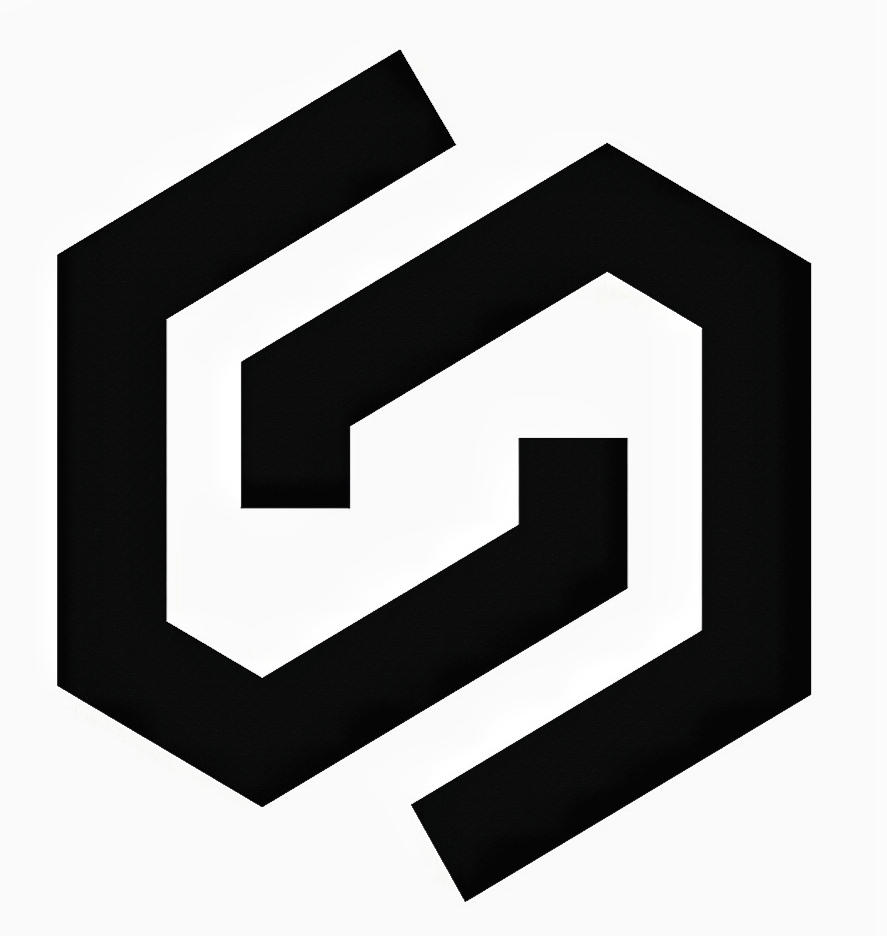
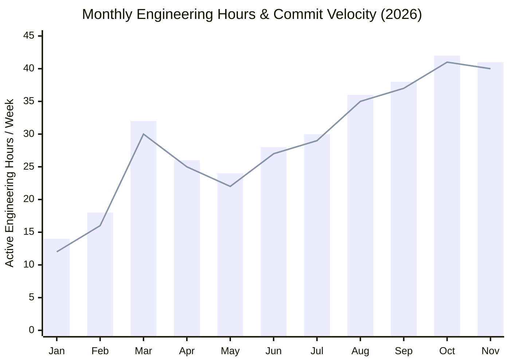
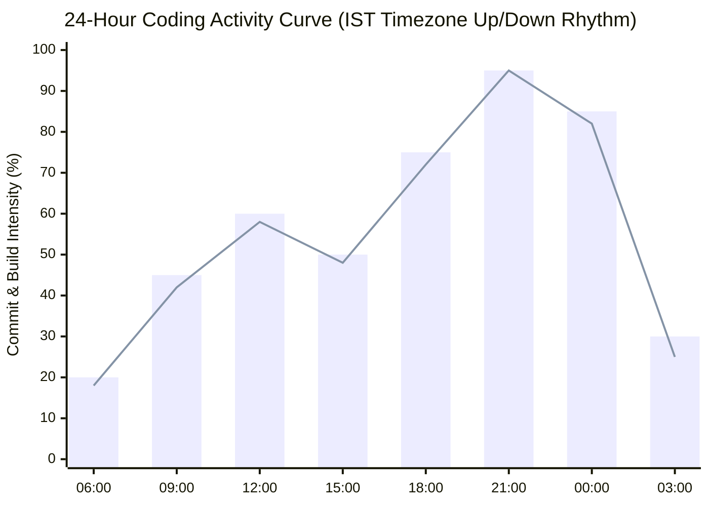
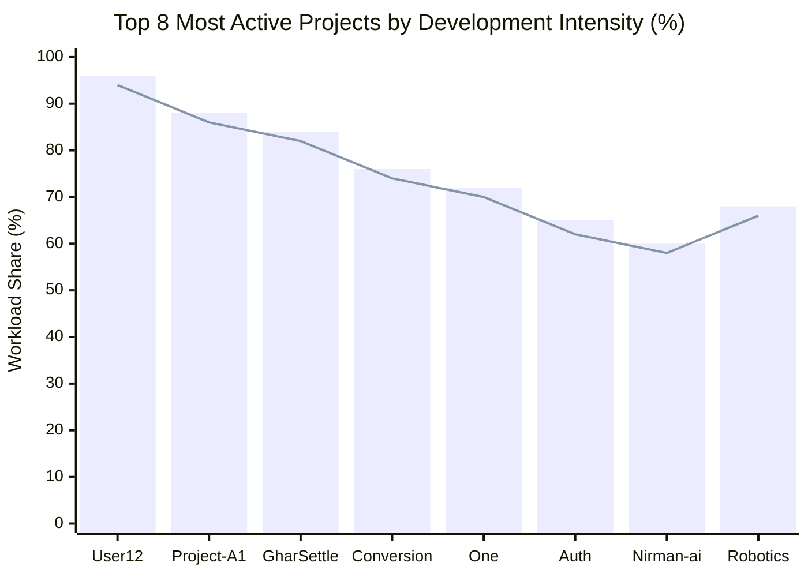
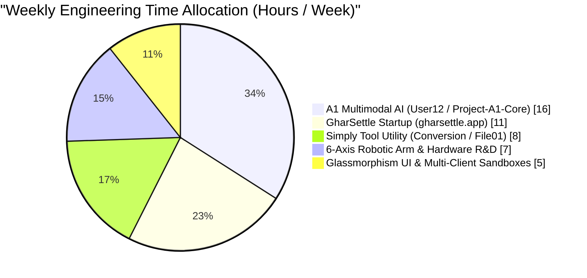
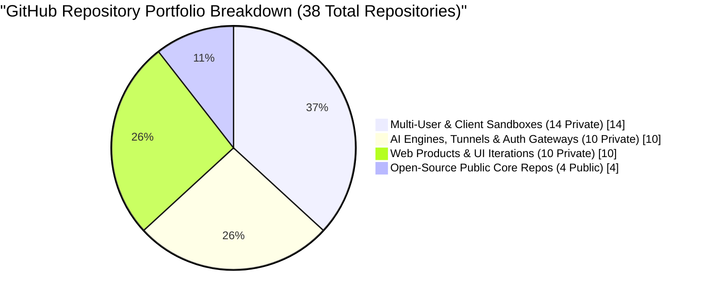
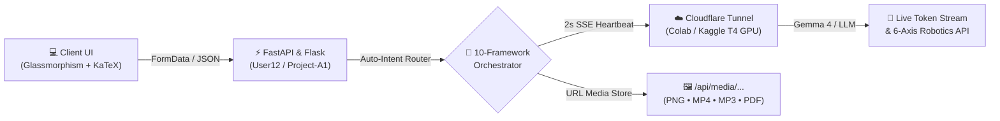
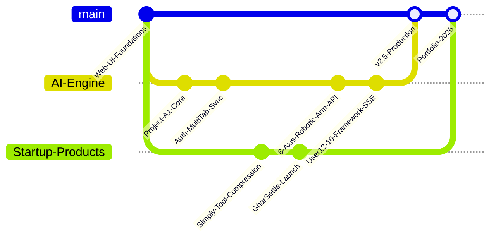

# Pawan Ahirwar 

<!-- AUTO LIGHT/DARK MODE TYPING ANIMATION (WHITE IN DARK MODE, BLACK IN LIGHT MODE) -->
<picture>
  <source media="(prefers-color-scheme: dark)" srcset="https://readme-typing-svg.demolab.com?font=Fira+Code&weight=600&size=19&duration=2600&pause=800&color=FFFFFF&center=true&vCenter=true&width=720&lines=Full-Stack+Developer+%26+AI+Systems+Architect;Founder+of+GharSettle+(gharsettle.app)+%26+Simply+Tool;Real-Time+Multimodal+AI+%26+SSE+Streaming+Engines;6-Axis+Robotics+%26+Edge-Cloud+Hardware+Builder;38%2B+Repositories+%7C+Shipping+Practical+Products" />
  <source media="(prefers-color-scheme: light)" srcset="https://readme-typing-svg.demolab.com?font=Fira+Code&weight=600&size=19&duration=2600&pause=800&color=111111&center=true&vCenter=true&width=720&lines=Full-Stack+Developer+%26+AI+Systems+Architect;Founder+of+GharSettle+(gharsettle.app)+%26+Simply+Tool;Real-Time+Multimodal+AI+%26+SSE+Streaming+Engines;6-Axis+Robotics+%26+Edge-Cloud+Hardware+Builder;38%2B+Repositories+%7C+Shipping+Practical+Products" />
  
</picture>

**Full-Stack Product Builder** &nbsp;•&nbsp; **Multimodal AI Engineer** &nbsp;•&nbsp; **Robotics & IoT Developer**

[**🌐 conversion tool**](https://simplytool.app) &nbsp;|&nbsp; [**📂 38+ GitHub Repositories**](https://github.com/Pawan7489?tab=repositories) &nbsp;|&nbsp;
[**⚡ Project-A1-Core**](https://github.com/Pawan7489/Project-A1-Core) &nbsp;|&nbsp; [**🧩 One Engine**](https://github.com/Pawan7489/One)

---

##  Engineering Mindset & How I Build

* **Execution-First Learning:** I learn by building and shipping real systems. Whenever I explore a new concept—whether it is low-latency Server-Sent Events (SSE), GPU tunnel routing, or 6-axis servo kinematics—I turn it directly into a live web platform or physical prototype.
* **Product-Driven Architecture:** I focus on solving real everyday friction:
  * **GharSettle (`gharsettle.app`):** Simplifying post-moving house setup, unboxing, and room organization.
  * **Simply Tool (`Conversion` / `File01`):** Hybrid file utility that compresses files under `4MB` directly in the browser and offloads heavier files to cloud workers.
  * **A1 Multimodal Workspace (`User12` / `Project-A1-Core`):** Unifying real-time chat, LaTeX math rendering, IDE code blocks, and URL-based Image, Video, Audio, PDF, and DOCX generation.
* **Software + Hardware Integration:** I work across both full-stack web applications (**Python, FastAPI, Flask, Uvicorn, JavaScript, MongoDB, Firebase**) and physical robotics (**Raspberry Pi, ESP32, Arduino, PWM Servo Controllers**) integrated with **Google Gemma 2.5 & Gemma 4** models.

---

##  Featured Products, Websites & Hardware Systems

| Product / Project | Type & Status | Core Stack | Architecture & Key Highlights |
| :--- | :--- | :--- | :--- |
| **🏠 GharSettle** (`gharsettle.app`) | **Startup Platform** *(Live)* | Full-Stack Web, Responsive UI, Cloud API | Post-moving house settlement platform for professional unboxing, furniture arrangement, and complete room organization. |
| **⚡ A1 Multimodal AI Server** (`User12` / `Project-A1-Core`) | **AI Workspace** *(Public & Prod)* | FastAPI, Flask, Uvicorn, JS, Firebase, MongoDB, Cloudflare | 10-Framework AI router featuring 2-second SSE heartbeats, universal KaTeX math rendering, and instant URL media delivery. |
| **🛠️ Simply Tool** (`Conversion` / `File01`) | **Web Utility** *(Active)* | JavaScript, HTML5/CSS3, Python Render Worker | Client-side compression for `<4MB` files and automated Render cloud processing for large documents and media. |
| **🤖 6-Axis AI Robotic Arm** | **Robotics & Edge AI** *(Exhibited)* | Raspberry Pi, ESP32, PWM Servo Boards, Gemma AI API | Built with a 5-member team; combines 6-DOF servo hardware with cloud/edge AI command execution. Exhibited at Science Fair with media coverage. |
| **📡 Offline SMS Disaster Net** | **Resilient Comms** *(Prototype)* | SMS Protocols, Open-Source Local DB | Emergency communication system designed to route alerts and query local databases without active internet access. |
| **♻️ E-Waste Component Loop** | **Hardware Workflow** *(R&D)* | Electronics Testing, Component Recovery | Structured workflow to recover working microcontrollers, sensors, and power modules from municipal e-waste for builders. |

---

##  Live Engineering Telemetry & Interactive Graphs

### 1. Monthly Commit Velocity & Engineering Output (Up/Down Trend)

### 2. Daily 24-Hour Coding Rhythm (When I Write Code)

### 3. Most Active Repositories by Commit & Build Volume

### 4. Weekly Time Distribution & 38-Repository Ecosystem Split

### 5. End-to-End Multimodal System Architecture

### 6. Project Evolution & Release Timeline

---

##  Complete Repository Index (38 Repositories)

### 🔓 Public Open-Source Repositories (4 Public)
| Repository | Primary Language | Description & Purpose | Activity |
| :--- | :--- | :--- | :--- |
| [**`Pawan7489/One`**](https://github.com/Pawan7489/One) | `JavaScript` | Modular frontend interaction engine and real-time DOM renderer | `▂▄▆█▇█` Active |
| [**`Pawan7489/Project-A1-Core`**](https://github.com/Pawan7489/Project-A1-Core) | `Python / JS` | Core architecture for the A1 Multimodal AI Assistant | `▃▅▆█▇█` Public Core |
| [**`Pawan7489/Project_A1`**](https://github.com/Pawan7489/Project_A1) | `Full-Stack` | Base workspace template and API routing layer | `▃▄▆▇▆▇` Public Release |
| [**`Pawan7489/A1-One`**](https://github.com/Pawan7489/A1-One) | `Web / API` | Unified starter kit for client-to-tunnel communication | `▂▄▅▆▇▇` Public |

### 🔒 Private Production & Sandbox Repositories (34 Private)
| Category | Repositories Included | Primary Focus |
| :--- | :--- | :--- |
| **🧠 AI Engines, Tunnels & Gateways (10)** | `User12`, `Nirman-ai`, `Gemini`, `Admin0`, `A1`, `Website-A1`, `Helper`, `Auth`, `Conversion`, `File01` | Production SSE streaming, Cloudflare auto-tunnels, Firebase multi-tab auth, and Simply Tool file workers. |
| **🌐 Web Platforms & UI Systems (10)** | `Website-`, `Website1`, `one01`, `New01`, `New03`, `New04`, `New0`, `New`, `B2`, `A` | Glassmorphism & Neumorphism dark/light adaptive interfaces and GharSettle web components. |
| **👥 Client & Deployment Sandboxes (14)** | `user13`, `User11`, `User10`, `User09`, `User07`, `User05`, `User04`, `User03`, `User01`, `User0`, `user`, `My01`, `Rohan01`, `Rohan0` | Isolated staging environments, live streaming stress tests, and multi-user chatroom ledgers. |

---

##  Tech Stack & Hardware Arsenal

| Layer | Tools & Technologies |
| :--- | :--- |
| **Frontend & UI/UX** | `JavaScript (ES6+)`, `HTML5`, `CSS3`, `Glassmorphism & Neumorphism`, `KaTeX Math Engine`, `EventSource (SSE)`, `Web Speech API` |
| **Backend & Cloud** | `Python`, `FastAPI`, `Flask`, `Uvicorn`, `MongoDB`, `Google Firebase Auth`, `Render Cloud`, `Cloudflare Tunnels`, `Colab & Kaggle T4 GPU` |
| **AI & Media Pipelines** | `Google Gemma 2.5 & Gemma 4`, `llama-cpp-python (CUDA)`, `OpenCV`, `Pillow`, `gTTS / Edge-TTS`, `MoviePy / ImageIO`, `ReportLab`, `python-docx` |
| **Robotics & Electronics** | `Raspberry Pi`, `ESP32`, `Arduino`, `6-Axis Servo Kinematics`, `PWM Servo Drivers`, `HC Bluetooth Modules`, `Lithium Power Circuits`, `AutoCAD` |

---

###  Let's Connect & Build Together

*Open to collaborating on **AI Web Platforms, Startup Products, Full-Stack Systems, and Robotics Hardware**.*

[**GitHub (@Pawan7489)**](https://github.com/Pawan7489) &nbsp;•&nbsp; [**conversion tool (simplytool.app)**](https://simplytool.app)

